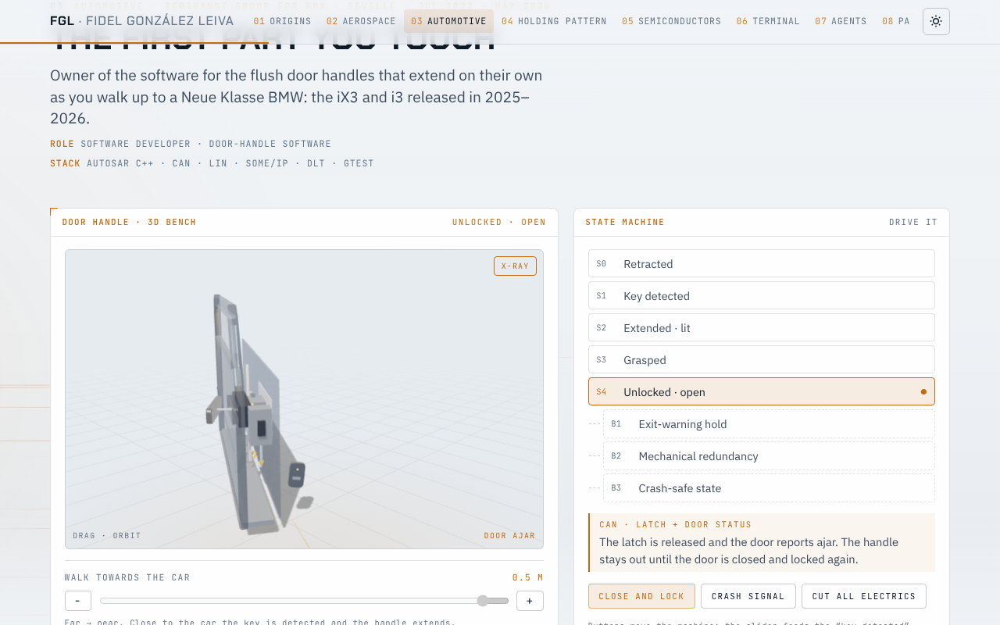
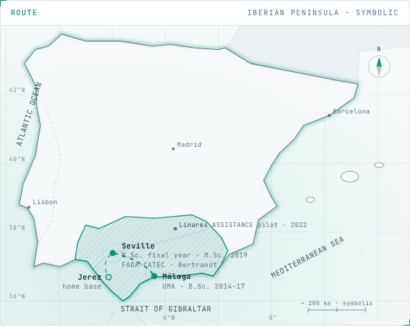
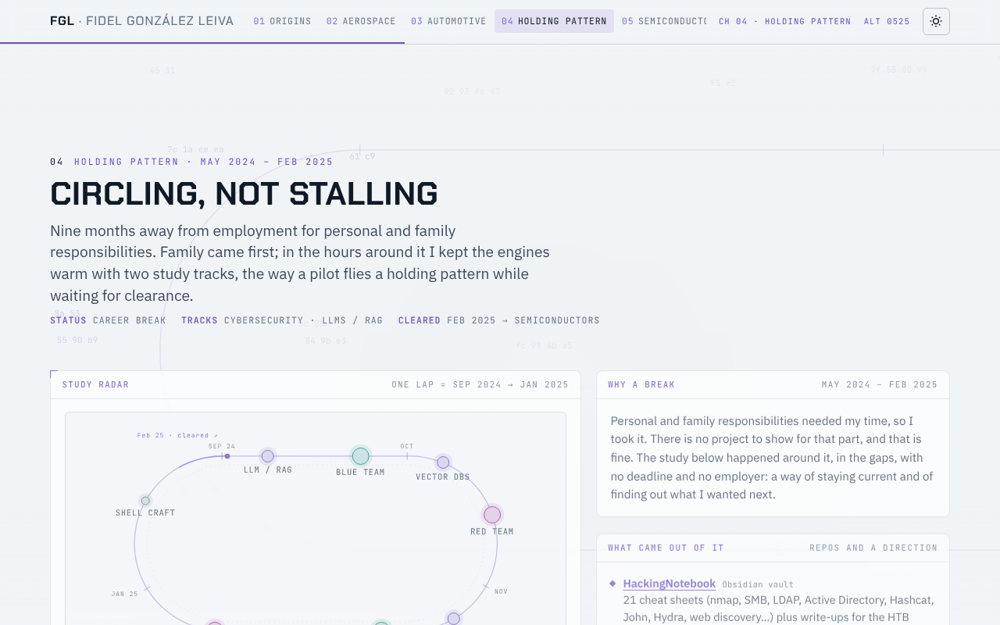
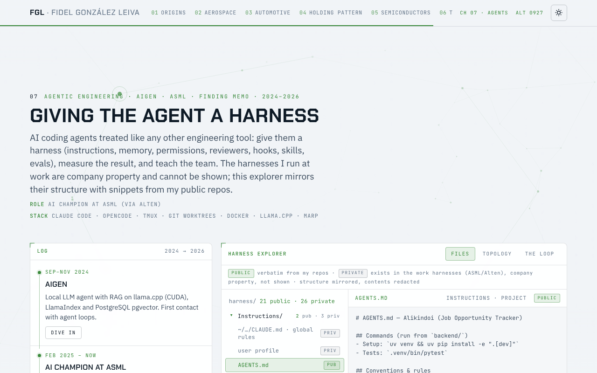

# Fidel González Leiva · portfolio

**Live site: [lotape6.github.io](https://lotape6.github.io/)**

A career told as a flight plan: nine chapters, one per sector, each with its own
background, an interactive element and dive-in panels with videos, papers and code.
Plain HTML, CSS and JavaScript, no framework, no tracking, no build step needed to view it.

| Door-handle bench (Three.js) | Symbolic Iberia map |
|---|---|
|  |  |

| Holding pattern (study radar) | Harness explorer |
|---|---|
|  |  |

## Chapters

| # | Chapter | Interactive element |
|---|---|---|
| 01 | Origins · Málaga and Seville | Projected, symbolic map of the Iberian Peninsula with the study and work route |
| 02 | Aerospace · FADA-CATEC | Radar scope and mission log: MBZIRC 2020, GAVIOTA, METRICS/RAMI, DELOREAN, ASSISTANCE, Piloto 5G |
| 03 | Automotive · Bertrandt for BMW | Three.js door bench driven by a generic handle state machine, plus an animated signal-flow board; plays a guided demo once on arrival |
| 04 | Holding pattern · 2024–25 | Racetrack study radar of the cybersecurity and LLM/RAG tracks |
| 05 | Semiconductors · Alten for ASML | Untangle-the-graph puzzle on build infrastructure |
| 06 | Terminal craft | A kitty/tmux window with the real dotfiles themes, sessionizer and daily tools |
| 07 | Agents | Harness explorer: files, topology and the agent loop, public snippets only |
| 08 | Papers | Three peer-reviewed papers with DOIs |
| 09 | Contact | Links, skills and a copy button for the email |

[Finding Memo](https://lotape6.github.io/FindingMemo/), the interactive guide to AI agents,
is a separate repository published under the same domain and linked from the site.

## How it is built

`index.html` is generated. Edit the sources and rebuild:

```sh
python3 build.py            # assembles index.html from src/
python3 -m http.server 8000 # then open http://localhost:8000
```

- `src/shell/page.html`: the page frame (head, top bar, theme button, footer).
- `src/chapters/NN-name.html`: one partial per chapter, included in filename order. The first
  line declares the chapter's CSS and JS; dive-in dialogs live after each section.
- `assets/css/core.css`, `assets/js/core.js`: design tokens (light and dark), the scroll-driven
  atmosphere stack (one canvas per chapter, faded by visibility), dive-in panels, video posters.
- `assets/css/chapters/`, `assets/js/chapters/`: one file per chapter.
- `src/CHAPTER_GUIDE.md`: conventions for adding or changing a chapter.
- `content/`: the verified facts and sources behind each chapter.
- `llms.txt`: plain-text profile for assistants and crawlers; the page head also carries
  schema.org Person JSON-LD.

### Theme
Light by default; the sun/moon button switches to dark and the choice is remembered in
`localStorage` (`fgl-theme`). Chapter canvases read their colours from the CSS tokens through
`ATMO.rgba`, so a new chapter needs no theme-specific code.

### Videos
```html
<div class="video" data-yt="YOUTUBE_ID" data-title="Caption shown on the poster"></div>
```
Nothing loads from YouTube until the visitor presses play (`youtube-nocookie.com`).

### 3D
The automotive chapter loads Three.js r128 from cdnjs. Without it, or without WebGL, the bench
falls back to a static drawing and the signal board keeps running the same state machine.

## Publishing
This repository is the GitHub user site, so every push to `main` is published at
[lotape6.github.io](https://lotape6.github.io/) within a minute or two. `.nojekyll` keeps
GitHub from running Jekyll over the files.

## Sources and privacy
Everything on the site comes from public sources: the CV, public repositories, published
papers, project websites and press material. Diagrams and demos are original drawings built on
open knowledge; the state machines, signal names and harness layouts are generic and do not
reproduce any employer's designs or data.
